<picture>
  <source media="(prefers-color-scheme: dark)" srcset="https://raw.githubusercontent.com/Abulkosim/Abulkosim/output/stats-dark.svg" />
  
</picture>

<a href="https://github.com/Abulkosim/margin"><picture>
  <source media="(prefers-color-scheme: dark)" srcset="https://raw.githubusercontent.com/Abulkosim/Abulkosim/output/margin-dark.svg" />
  
</picture></a>
<a href="https://github.com/Abulkosim/wick"><picture>
  <source media="(prefers-color-scheme: dark)" srcset="https://raw.githubusercontent.com/Abulkosim/Abulkosim/output/wick-dark.svg" />
  
</picture></a>
<a href="https://github.com/Abulkosim/weir"><picture>
  <source media="(prefers-color-scheme: dark)" srcset="https://raw.githubusercontent.com/Abulkosim/Abulkosim/output/weir-dark.svg" />
  
</picture></a>
<a href="https://github.com/Abulkosim/typeprose"><picture>
  <source media="(prefers-color-scheme: dark)" srcset="https://raw.githubusercontent.com/Abulkosim/Abulkosim/output/typeprose-dark.svg" />
  
</picture></a>

<picture>
  <source media="(prefers-color-scheme: dark)" srcset="https://raw.githubusercontent.com/Abulkosim/Abulkosim/output/cadence-dark.svg" />
  
</picture>

```sh
brew install --cask abulkosim/tap/wick
brew install --cask abulkosim/tap/weir
```

### How the apps ship

CI builds every release. Each one comes with SHA-256 sums, an SBOM, and build provenance you can check with `gh attestation verify`.

The apps check for updates once a day. Updates are signed, and nothing installs until you say so.

Actions are pinned to commit SHAs. Every app runs Scorecard, `cargo audit`, `cargo deny` and `pnpm audit`. Margin and Weir also run CodeQL, and Weir's parsers are fuzzed.

There is no telemetry and no account. Each app's privacy notes say what it reads and what it sends.

### Other things

- [nudge](https://github.com/Abulkosim/nudge): a Telegram bot for replies and documents you're waiting on.
- [gitlab-discord-team-watch](https://github.com/Abulkosim/gitlab-discord-team-watch): posts GitLab team activity to Discord, plus a daily list of merge requests waiting for review.
- [skills](https://github.com/Abulkosim/skills): agent skills for merge request descriptions, release notes and meeting summaries.

<sub>[scripts/render.mjs](scripts/render.mjs) draws these cards from the GitHub API every six hours. Downloads count installers, not update checks. The typeprose passage changes daily.</sub>
