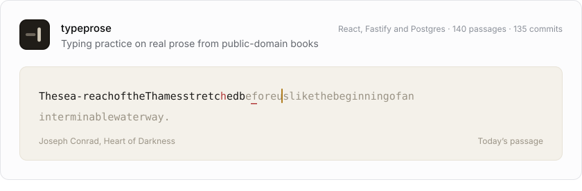
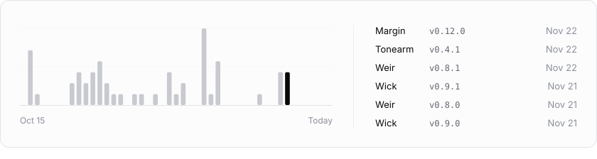

<picture>
  <source media="(prefers-color-scheme: dark)" srcset="https://raw.githubusercontent.com/Abulkosim/Abulkosim/e2614226651cd2221b6d8ec0de1eca345ac77471/apps-dark.svg" />
  
</picture>
<a href="https://github.com/Abulkosim/typeprose">
<picture>
  <source media="(prefers-color-scheme: dark)" srcset="https://raw.githubusercontent.com/Abulkosim/Abulkosim/e2614226651cd2221b6d8ec0de1eca345ac77471/typeprose-dark.svg" />
  
</picture>
</a>
<a href="https://github.com/Abulkosim/earthrise">
<picture>
  <source media="(prefers-color-scheme: dark)" srcset="https://raw.githubusercontent.com/Abulkosim/Abulkosim/e2614226651cd2221b6d8ec0de1eca345ac77471/earthrise-dark.svg" />
  
</picture>
</a>
<picture>
  <source media="(prefers-color-scheme: dark)" srcset="https://raw.githubusercontent.com/Abulkosim/Abulkosim/e2614226651cd2221b6d8ec0de1eca345ac77471/cadence-dark.svg" />
  
</picture>

### Install

```sh
brew install --cask abulkosim/tap/wick
brew install --cask abulkosim/tap/weir
brew install --cask abulkosim/tap/tonearm
```

Margin and the Windows and Linux builds are on each app's page: [Margin](https://github.com/Abulkosim/margin), [Wick](https://github.com/Abulkosim/wick), [Weir](https://github.com/Abulkosim/weir), [Tonearm](https://github.com/Abulkosim/tonearm).

### How I ship

I build every release in CI, with checksums and build provenance you can check with `gh attestation verify`. Updates are signed and install only when you say so. No telemetry. No account.

### Also

- **[realsoft-chrome-extension](https://github.com/Abulkosim/realsoft-chrome-extension)** Signs RealSoft employees in to the office Wi-Fi in one click. 73 people use it, from the [Chrome Web Store](https://chromewebstore.google.com/detail/realsoft/hhekakkemegiocboammljekhcefhfhgb).
- **[nudge](https://github.com/Abulkosim/nudge)** A Telegram bot for replies and documents you're waiting on.
- **[gitlab-discord-team-watch](https://github.com/Abulkosim/gitlab-discord-team-watch)** Posts GitLab team activity to Discord, with a daily list of merge requests waiting for review.
- **[skills](https://github.com/Abulkosim/skills)** Agent skills for merge request descriptions, release notes and meeting summaries.

<sub>The cards above are drawn from the GitHub API every six hours by [scripts/render.mjs](scripts/render.mjs), set in Inter and JetBrains Mono (SIL Open Font License). Downloads count installers, not update checks. The typeprose passage changes daily.</sub>
