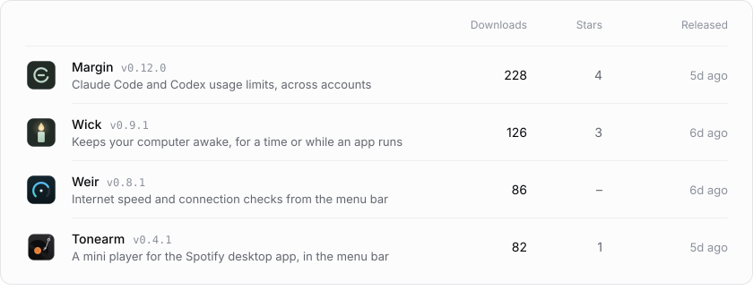
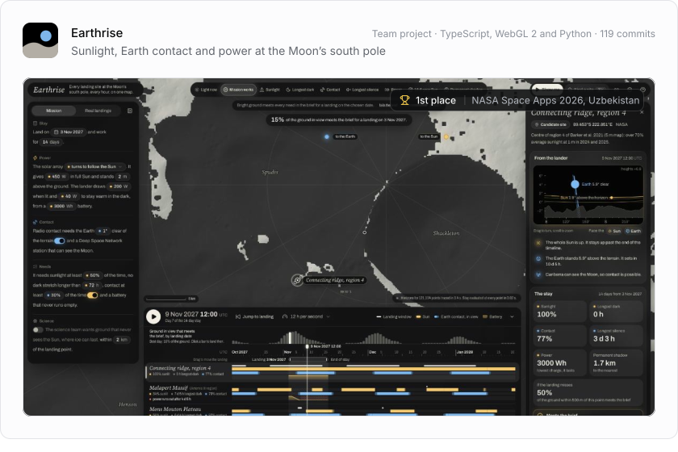

<picture>
  <source media="(prefers-color-scheme: dark)" srcset="https://raw.githubusercontent.com/Abulkosim/Abulkosim/output/stats-dark.svg" />
  
</picture>

<picture>
  <source media="(prefers-color-scheme: dark)" srcset="https://raw.githubusercontent.com/Abulkosim/Abulkosim/output/apps-dark.svg" />
  
</picture>

[Margin](https://github.com/Abulkosim/margin) · [Wick](https://github.com/Abulkosim/wick) · [Weir](https://github.com/Abulkosim/weir) · [Tonearm](https://github.com/Abulkosim/tonearm)

<a href="https://github.com/Abulkosim/typeprose">
<picture>
  <source media="(prefers-color-scheme: dark)" srcset="https://raw.githubusercontent.com/Abulkosim/Abulkosim/output/typeprose-dark.svg" />
  
</picture>
</a>
<a href="https://github.com/Abulkosim/earthrise">
<picture>
  <source media="(prefers-color-scheme: dark)" srcset="https://raw.githubusercontent.com/Abulkosim/Abulkosim/output/earthrise-dark.svg" />
  
</picture>
</a>

<picture>
  <source media="(prefers-color-scheme: dark)" srcset="https://raw.githubusercontent.com/Abulkosim/Abulkosim/output/cadence-dark.svg" />
  
</picture>

```sh
brew install --cask abulkosim/tap/wick
brew install --cask abulkosim/tap/weir
brew install --cask abulkosim/tap/tonearm
```

### How the apps ship

CI builds every release, with checksums and build provenance you can check with `gh attestation verify`. Updates are signed and install only when you say so. No telemetry, no account.

### Other things

- [realsoft-chrome-extension](https://github.com/Abulkosim/realsoft-chrome-extension): signs RealSoft employees in to the office Wi-Fi with one click. 73 people use it, from the [Chrome Web Store](https://chromewebstore.google.com/detail/realsoft/hhekakkemegiocboammljekhcefhfhgb).
- [nudge](https://github.com/Abulkosim/nudge): a Telegram bot for replies and documents you're waiting on.
- [gitlab-discord-team-watch](https://github.com/Abulkosim/gitlab-discord-team-watch): posts GitLab team activity to Discord, plus a daily list of merge requests waiting for review.
- [skills](https://github.com/Abulkosim/skills): agent skills for merge request descriptions, release notes and meeting summaries.

<sub>[scripts/render.mjs](scripts/render.mjs) draws these cards from the GitHub API every six hours. Downloads count installers, not update checks. The typeprose passage changes daily.</sub>
